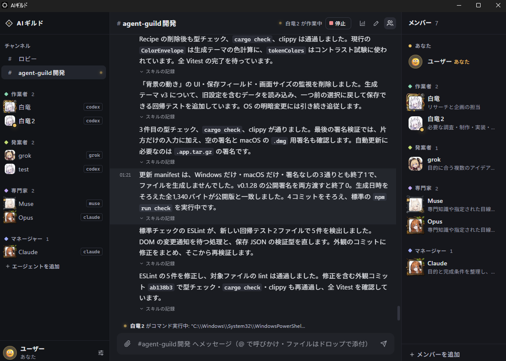

# AI 길드

[English](README.md) | [日本語](README.ja.md) | [简体中文](README.zh-CN.md) | [繁體中文](README.zh-TW.md) | **한국어**

사람과 AI 에이전트가 채널에서 대화하며 함께 일하는 데스크톱 앱입니다.
Claude, Codex, Ollama, DeepSeek, Gemini 같은 모델을 "동료"로 등록하고, Slack 같은 채널에서 부르거나 일을 맡길 수 있습니다.

> v1.0.3으로 업데이트하면 기존 매니저도 평소에는 짧고 쉬운 말로 답합니다. "더 자세히"라고 부탁하면 그 답장만 자세해집니다. [v1.0.3 변경 사항](docs/releases/v1.0.3.md) (일본어)
>
> v0.1.28에서 업데이트하면 첫 실행 때 DB를 백업한 뒤 변환합니다. 그보다 이전 버전을 쓰고 있다면 먼저 v0.1.28로 같은 데이터 폴더를 한 번 여십시오. [업데이트 절차와 백업 위치](docs/releases/v1.0.0.md) (일본어)



## 특징

- **채널에서 대화**: `@이름`으로 에이전트를 부르면 답합니다. 멘션이 없는 메시지에 누가 답할지는 에이전트마다 정할 수 있습니다.
- **에이전트 만들기**. 이름, 아바타, 역할, 성격, 말투, 전문 분야와 함께 사용할 백엔드와 모델을 설정합니다. 역할은 작업자, 아이디어 담당, 전문가, 매니저 4가지 중에서 고릅니다. 먼저 작업자 한 명으로 시작하고, 필요해지면 동료를 추가하십시오.
- **권한은 역할에 따라 정해짐**: 하나하나 스위치를 켤 필요가 없습니다. 작업자는 백엔드가 지원하는 모든 기능을 쓰고, 아이디어 담당·전문가·매니저는 작업 공간 안에서의 작업을 기본으로 하여 사용하는 백엔드에 맞게 자동으로 조정됩니다.
- **상담과 위임**: 작업자는 조사하면서 만들고 확인하며, 필요하면 아이디어 담당에게 아이디어를, 전문가에게 판단을 구할 수 있습니다. 매니저는 일을 나눌 필요가 있는지 판단하고, 결과를 확인해 정리합니다.
- **채널 운영 통계**. 채널 오른쪽 위에서 지금까지의 위임과 결과 보고율을 확인할 수 있습니다. 새로운 실행은 모델별로 시간, 수집할 수 있었던 토큰 수, 추정 API 비용을 집계합니다.
- **역할에 맞는 내장 스킬**: 에이전트를 만들거나 역할을 바꾸면 아이디어 담당에게는 관점 전환과 성찰, 전문가에게는 협업과 비평, 매니저에게는 일의 위임과 결과 정리, 회고, 듣는 사람에 맞춘 설명(ELI5)의 안내서가 붙습니다. 전문가의 협업 규칙은 스킬 목록에서 빼도 전문가인 동안에는 매번 실행 시 적용됩니다.
- **스킬**: Agent Skills(`SKILL.md`) 형식의 안내서를 에이전트에게 줄 수 있습니다. 내 컴퓨터의 스킬 폴더에서 추가할 수도 있습니다.
- **스스로 행동**: 정해 둔 간격마다 에이전트가 스스로 조사하거나 제안합니다.
- **기억**: 각 에이전트는 자신의 작업 공간에 있는 `MEMORY.md`에 다음을 위한 메모를 남깁니다.

## 메시지 본문의 서식 문법

채팅에 `[절차](<D:/Docs/작업 절차.md>)`처럼 쓰면, 절차를 클릭해 기본 앱에서 읽을 수 있습니다. Shift+클릭하면 폴더에서 표시합니다.

Markdown 외에도 채팅 메시지의 일부를 다음과 같이 꾸밀 수 있습니다.

- `:t[으음]{color=red size=2.5 rotate=180 weight=bold}` — 색, 글자 크기(em 배율), 회전(도), 굵기. 색은 red 같은 기본 이름 또는 `#rgb` / `#rrggbb`입니다.
- `:chars[꾸깃꾸깃]{bend=6 drift=0.3}` — 글자마다 각도와 가로 위치를 바꿉니다. `rotate="0 5 10" dx="0 0.2 0.4" dy="0 0 0.2"`처럼 하나씩 지정할 수도 있습니다. 각도는 도, 위치는 em 단위입니다.
- `:path[구불구불]{d="M0,80 C100,20 200,20 300,80" size=1.4}` — 글자를 SVG 경로를 따라 배치합니다.
- `:::layout{vertical rotate=-8}`부터 `:::`까지 — 공백과 줄바꿈을 유지하고 자동 줄바꿈을 멈춥니다. `vertical`은 세로쓰기입니다. 범위 안에서도 일반 강조와 위의 서식을 쓸 수 있습니다. 가로쓰기는 `:::layout{rotate=-8}`로 씁니다.

크기는 0.5~5, 각도는 -360~360, 글자별 이동은 -20~20 em입니다. 범위를 벗어난 값이나 잘못된 문법은 그대로 텍스트로 표시됩니다. 코드 안에서는 해석하지 않습니다.

## 필요한 것

배포판에는 실행기용 Node.js가 포함되어 있습니다. 사용하는 백엔드에 필요한 것을 준비하십시오.

DeepSeek과 Gemini는 설정 → 백엔드에서 API 키를 저장한 뒤 에이전트에서 모델을 고릅니다. Gemini는 Developer API로 지원합니다. 두 백엔드의 도구는 읽기 전용이며, 이미지·검색·쓰기·명령 실행은 지원하지 않습니다. 지원 범위와 연결 확인의 의미는 [DeepSeek / Gemini](docs/deepseek-gemini.md) (일본어)를 참고하십시오.

- Claude: [Claude Code](https://code.claude.com/docs/ko/quickstart). macOS에서는 설정 → 백엔드 → Claude에서 설정하고, 필요하면 Claude Code가 여는 브라우저에서 로그인합니다.
- Codex: [Codex CLI](https://learn.chatgpt.com/docs/codex/cli#install-codex). macOS에서는 설정 → 백엔드 → Codex에서 설정하고, 필요하면 브라우저에서 ChatGPT에 로그인합니다. 다른 OS에서는 같은 화면에서 절차를 열 수 있습니다.
- **Ollama**. "에이전트 추가"에서 **Ollama(이 PC)** 항목을 고르면 Gemma, DeepSeek 같은 설치된 대화 모델 중에서 선택할 수 있습니다. Mac에서는 Ollama가 멈춰 있으면 **Ollama 시작**을 누르면 모델 목록이 자동으로 갱신됩니다. 이미지를 지원하는 모델에는 첨부 이미지도 전달할 수 있습니다. 모델을 추가한 직후에는 설정 → 백엔드 → 모두 다시 확인으로 목록을 갱신할 수 있습니다. [Ollama](https://ollama.com/)

Claude와 Codex의 사용료는 각 서비스의 본인 계정에 청구됩니다.

## 실행

설치 프로그램(Windows x64, macOS Apple Silicon)은 [GitHub Releases](https://github.com/tobyapi/agent-guild/releases)에서 무료로 내려받을 수 있습니다. 소스에서 빌드해 실행할 수도 있습니다.

빌드에는 Node.js 24, [Rust](https://www.rust-lang.org/)(1.89 이상), [Tauri 사전 요구 사항](https://tauri.app/start/prerequisites/)(Windows는 WebView2와 Visual Studio Build Tools, macOS는 Xcode Command Line Tools)이 필요합니다.

```bash
npm install
npm run app
```

처음 실행하면 대화 상자에서 이름, 스킬 폴더, 데이터 저장 위치를 정합니다(모두 나중에 설정에서 바꿀 수 있습니다). 로비("ロビー"라는 이름)에는 작업자 "ミナト" 한 명이 있습니다. 설정 → 백엔드에서 Codex를 준비하면 대화할 수 있습니다.

### 명령

| 명령 | 내용 |
|---|---|
| `npm run app` | 개발 모드로 앱 실행 |
| `npm run dev` | UI만 브라우저에서 실행(백엔드는 모의 구현. `?mockSetup=1`은 첫 설정, `?mockDemo=1`은 예시 대화, `?mockBoot=missing`은 복구 화면 표시) |
| `npm run bundle` | 배포용 앱과 설치 프로그램 빌드 |
| `npm run format` | 코드 정리(TS와 CSS는 Prettier, Rust는 cargo fmt) |
| `npm run check` | 서식 검사, 타입 검사, lint, 유지보수성 검사, 테스트, clippy, Rust 테스트를 한꺼번에 실행 |

GitHub Actions([.github/workflows/build.yml](.github/workflows/build.yml))로 Windows(x64)와 macOS(Apple Silicon)용 설치 프로그램을 빌드할 수 있습니다(수동 실행 또는 `v*` 태그 push). 태그 빌드에서는 자동 업데이트용 서명과 `latest.json`도 만들어 초안 릴리스에 첨부합니다. 릴리스를 공개하면 이미 배포된 앱이 새 버전을 찾습니다(구조와 절차는 [docs/design.md](docs/design.md) (일본어)의 "アプリの更新"(앱 업데이트)을 참고하십시오). `npm run check`는 main으로의 push와 pull request마다 GitHub Actions([.github/workflows/check.yml](.github/workflows/check.yml))에서도 실행됩니다.

로컬에서는 변경과 관련된 테스트, 타입 검사, lint만 골라 실행합니다. 문서만 바꾼 경우에는 차이 확인으로 충분합니다. 전체 검사는 기본적으로 CI에 맡기고, 영향 범위가 넓은 변경 등 필요할 때 실행합니다. 자세한 내용은 [CLAUDE.md](CLAUDE.md) (일본어)의 "ローカルでの検証"(로컬 검증)을 참고하십시오.

## 안전

에이전트는 이 PC에서 사용자와 같은 권한으로 움직입니다. 맡기는 일에 필요한 권한만 주십시오.

- 권한은 백엔드마다 확실히 강제할 수 있는 형태로 구현되어 있습니다(강제할 수 없는 조합은 저장할 수 없습니다).
- "명령 실행"과 "작업 공간 밖에도 쓰기"는 파일 삭제나 외부 전송도 할 수 있는 강한 권한입니다. 편집 화면에 경고가 표시됩니다.
- 웹 페이지나 파일에 숨겨진 지시(프롬프트 인젝션)에 대비해, 에이전트에게 자료를 다루는 방법을 전하고, 파일을 읽어 외부로 보낼 수 있는 권한 조합에는 경고를 표시합니다. 비밀처럼 보이는 이름의 환경 변수는 명령에 넘기지 않습니다. Claude 에이전트는 명령 실행이나 웹 페이지 열기 전에 소형 모델로 요청과 맞는지 확인하고, 의심스러우면 멈춥니다.
- 이런 구조는 피해를 줄이는 것이며, 완전히 막을 수는 없습니다. 중요한 데이터나 비밀을 다룰 때는 권한을 좁힌 에이전트를 사용하십시오.

## 데이터 저장 위치

채널, 에이전트, 대화, 작업 공간은 데이터 폴더(기본값은 앱의 데이터 위치. 설정에서 변경 가능)에 저장됩니다. 기기별 설정(데이터 폴더 위치와 스킬 폴더)은 OS의 앱 설정 위치에 있는 `settings.json`에 저장됩니다.

## 개발자용

- 사양, IPC 계약, 실행 구조, 데이터 폴더: [docs/design.md](docs/design.md) (일본어)
- 코드 구조와 확장 방법: [docs/architecture.md](docs/architecture.md) (일본어)
- 외관 디자인 지침: [docs/ui-design.md](docs/ui-design.md) (일본어)
- 개발 방침과 유지보수성 검사: [CLAUDE.md](CLAUDE.md) (일본어)

앱은 React(화면), Rust / Tauri(앱 본체), agent-runner(각 백엔드에서 에이전트를 실행하는 Node 프로세스)의 세 부분으로 이루어져 있습니다.

## 코드 서명 정책

Windows 설치 프로그램의 코드 서명을 위해 [SignPath Foundation](https://signpath.org/)의 무료 프로그램에 신청했습니다. 승인될 때까지 설치 프로그램은 서명되지 않습니다. 무엇에 어떻게 서명하는지, 책임자, 개인정보 처리방침은 [코드 서명 정책](CODE_SIGNING_POLICY.md) (영어)에 정리되어 있습니다. 설정과 절차: [docs/code-signing.md](docs/code-signing.md) (일본어).

## 개인정보 보호(개인정보 처리방침)

이 앱은 사용자가 요청한 경우를 제외하고 네트워크로 연결된 다른 시스템에 정보를 보내지 않습니다. 예외는 다음과 같습니다(영어 전문은 [코드 서명 정책](CODE_SIGNING_POLICY.md#privacy-policy)).

- **업데이트 확인**: 시작할 때, 앱으로 돌아오거나 연결이 복구될 때, 그리고 5분마다 GitHub Releases(`https://github.com/tobyapi/agent-guild/releases/latest/download/latest.json`)에서 새 버전을 확인합니다. 보내는 것은 일반 HTTPS 요청뿐이며, 대화나 파일 내용은 보내지 않습니다. 설정 → 앱 업데이트에서 "새 버전 자동 확인"을 끄면 [업데이트 확인]을 눌렀을 때만 확인합니다.
- **AI 백엔드**: 에이전트에게 말을 걸면 그 에이전트에 설정된 백엔드(Claude Code, Codex CLI, Ollama 등)에 대화를 넘깁니다. 전송 대상과 데이터 처리는 각 서비스의 개인정보 처리방침을 따릅니다. Ollama(이 PC)는 기기 밖으로 보내지 않습니다.
- **캐릭터 도감**: 도감 선택 화면을 열었을 때만 도감 사이트에서 이미지를 가져옵니다.

## 라이선스

소프트웨어는 [MIT](LICENSE)입니다. 참여할 때는 [행동 강령](CODE_OF_CONDUCT.md) (영어)을 따라 주십시오. Windows판에는 명령을 격리해 실행하기 위한 Microsoft 실행 파일([MXC](https://github.com/microsoft/mxc)의 `wxc-exec.exe`, MIT)이 포함되어 있습니다.

## 감사의 말

에이전트의 "캐릭터 도감"은 Gender Swap AI의 캐릭터 도감을 참고했습니다. 캐릭터 일러스트를 공개하신 ZipZipPipe 님, DeepSeek 원작 캐릭터를 만드신 上善无形 님께 감사드립니다. [AI 의인화 캐릭터 도감](https://genderswapai.com/ko/ai-gijinka) · [ZipZipPipe](https://space.bilibili.com/4168597/dynamic)

앱은 [캐릭터 도감](https://genderswapai.com/ko/ai-gijinka)에서 이미지를 불러옵니다. 에이전트 아바타는 얼굴을 정사각형으로 자릅니다. 도감 마스코트는 기기에서 전신 이미지의 배경을 제거하며 JEV는 원본 투명도를 유지합니다. 선택한 이미지는 이 기기에 저장됩니다.

도감 캐릭터 이미지는 앱의 MIT 라이선스 적용 대상에서 제외되며 상업적으로 사용할 수 없습니다. [ZipZipPipe의 이용 조건](https://www.pixiv.net/artworks/148186519)에 따라 작가를 표기해야 합니다. DeepSeek는 上善无形과 ZipZipPipe를 표기하며 [CC BY-NC-SA 4.0](https://creativecommons.org/licenses/by-nc-sa/4.0/)이 적용됩니다. JEV의 라이선스 및 사용 허가는 미확인 상태입니다. 작가, 원본 게시물, 변경 사항은 **설정 → 앱 → 라이선스 고지**를 참조하십시오.
