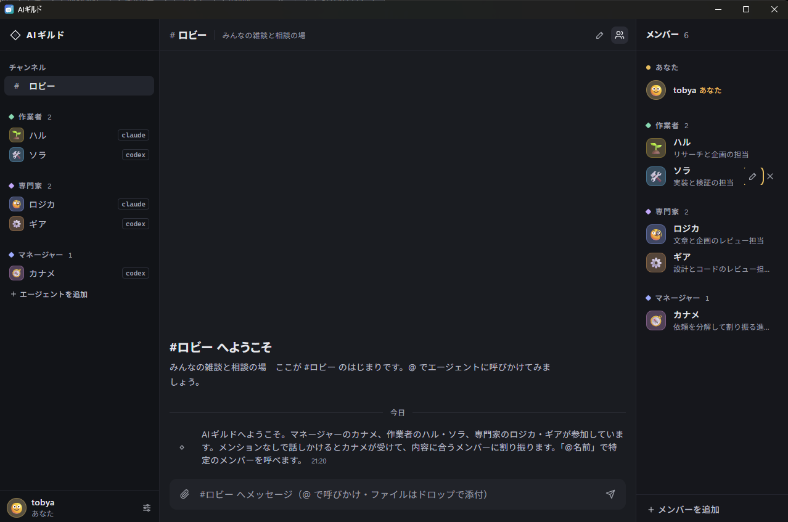

# AIギルド

人間と AI エージェントが、チャンネルで会話しながら一緒に仕事をするデスクトップアプリです。
Claude、Codex、Ollama のモデルを「仲間」として登録し、Slack のようなチャンネルで呼びかけたり、仕事を割り振ったりできます。

> まだリリース前（0.1.0）です。データの形や設定は予告なく変わることがあります。



## できること

- **チャンネルで会話する**: `@名前` で呼びかけると、そのエージェントが答えます。メンションのない発言に誰が答えるかは、エージェントごとに決められます。
- **エージェントを作る**。名前・アバター・役割・性格・口調・得意分野と、使うバックエンド・モデルを設定します。作業者・専門家・マネージャーなどのテンプレートから始められます。
- **できることを権限で決める**: Web 検索、Web ページを読む、ファイルの読み書き、作業フォルダの外への書き込み、コマンドの実行、スキルの利用を、エージェントごとに許可します。
- **相談と割り振り**: エージェント同士で相談したり、マネージャー役が仕事を分けて仲間に割り振り、結果をまとめて報告したりします。
- **スキル**: Agent Skills（`SKILL.md`）の形式で手引きを持たせられます。手元のスキルのフォルダから追加することもできます。
- **自分から動く**: 決めた間隔で、エージェントが自分から調べものや提案をします。
- **記憶**: エージェントごとの作業フォルダにある `MEMORY.md` に、次回以降のためのメモを残します。

## 必要なもの

配布版にはランナー用の Node.js が入っています。使うバックエンドに合わせて準備してください。

- Claude: [Claude Code](https://code.claude.com/docs/ja/quickstart)。macOS では「設定 → バックエンド → Claude」でセットアップし、必要なら Claude Code が開くブラウザーでログインできます。
- Codex: [Codex CLI](https://learn.chatgpt.com/docs/codex/cli#install-codex)。macOS では「設定 → バックエンド → Codex」でセットアップし、必要ならブラウザーで ChatGPT にログインできます。ほかの OS では同じ画面で手順を開けます。
- **Ollama**。モデルを入れた状態で Ollama アプリを起動します。「エージェントを追加」で **Ollama（この PC）** を選ぶと、Gemma や DeepSeek など、インストール済みの会話モデルを選べます。画像対応のモデルには添付画像も渡せます。モデルを追加した直後は「設定 → バックエンド → すべて再確認」で一覧を更新できます。[Ollama](https://ollama.com/)

Claude と Codex の利用料は、それぞれのサービスのアカウントに対して発生します。

## 動かす

配布用のインストーラーはまだ公開していません。ソースからビルドして動かします。

ビルドには Node.js 24、[Rust](https://www.rust-lang.org/)（1.89 以降）、[Tauri の前提ソフト](https://tauri.app/start/prerequisites/)（Windows なら WebView2 と Visual Studio Build Tools、macOS なら Xcode Command Line Tools）が要ります。

```bash
npm install
npm run app
```

初めて起動すると、あなたの名前・スキルのフォルダ・データの保存先を決めるダイアログが出ます（どれもあとから設定で変えられます）。

### コマンド

| コマンド | 内容 |
|---|---|
| `npm run app` | アプリを開発モードで起動する |
| `npm run dev` | 画面だけをブラウザで起動する（バックエンドはモック。`?mockSetup=1` で初回起動のダイアログ、`?mockBoot=missing` で復旧画面を確かめられる） |
| `npm run bundle` | 配布用のアプリとインストーラーを作る |
| `npm run format` | コードを整形する（TS・CSS は Prettier、Rust は cargo fmt） |
| `npm run check` | 整形の確認・型チェック・lint・保守性の検査・テスト・clippy・Rust のテストをまとめて実行する |

GitHub Actions（[.github/workflows/build.yml](.github/workflows/build.yml)）で、Windows（x64）と macOS（Apple Silicon）のインストーラーを作れます（手動実行か `v*` のタグの push で動きます）。`npm run check` は、main への push とプルリクエストのたびに GitHub Actions（[.github/workflows/check.yml](.github/workflows/check.yml)）でも走ります。

## 安全について

エージェントは、あなたの PC の上で、あなたと同じ権限で動きます。許可する権限は、任せる仕事に必要な分だけにしてください。

- 権限は、バックエンドごとに確実に守れる形で実装しています（守れない組み合わせは保存できません）。
- 「コマンドを実行」「作業フォルダの外にも書く」は、ファイルの削除や外部への送信もできてしまう強い権限です。編集画面で注意を出します。
- Web ページやファイルに紛れた指示（プロンプトインジェクション）への備えとして、エージェントに資料の扱い方を伝え、ファイルを読んで外へ送れてしまう権限の組み合わせには警告を出します。秘密らしい名前の環境変数はコマンドに渡しません。Claude のエージェントは、コマンドの実行や Web ページを開く前に、小さいモデルで依頼に沿っているかを確かめ、怪しければ止めます。
- これらは被害を減らすための仕組みで、完全に防げるものではありません。大事なデータや秘密を扱うときは、権限を絞ったエージェントを使ってください。

## データの保存先

チャンネル・エージェント・会話・作業フォルダは、データフォルダ（既定ではアプリのデータの場所。設定で変えられます）に保存します。マシンごとの設定（データフォルダの場所・スキルのフォルダ）は、OS のアプリの設定の場所にある `settings.json` に保存します。

## 開発者向け

- 仕様・IPC の契約・実行のしかた・データフォルダ: [docs/design.md](docs/design.md)
- コードの構造と拡張のしかた: [docs/architecture.md](docs/architecture.md)
- 見た目の指針: [docs/ui-design.md](docs/ui-design.md)
- 開発の方針と保守性の検査: [CLAUDE.md](CLAUDE.md)

構成は、React（画面）・Rust / Tauri（アプリの本体）・agent-runner（各バックエンドでエージェントを動かす Node のプロセス）の3つです。

## ライセンス

[MIT](LICENSE)
