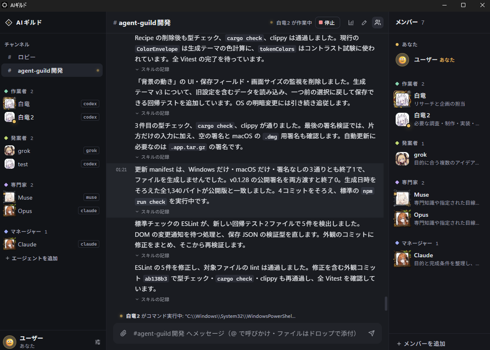

# AI Guild

**English** | [日本語](README.ja.md) | [简体中文](README.zh-CN.md) | [繁體中文](README.zh-TW.md) | [한국어](README.ko.md)

A desktop app where humans and AI agents work together while talking in channels.
Register models such as Claude, Codex, Ollama, DeepSeek, and Gemini as "teammates," then call on them or assign them work in Slack-like channels.

> When you update to v1.0.3, your existing managers will also give short, plain answers by default. Ask for "more detail" and only that reply becomes detailed. [What's new in v1.0.3](docs/releases/v1.0.3.md) (Japanese)
>
> When you update from v0.1.28, the app backs up and converts the DB on first launch. If you use an earlier version, open the same data folder once with v0.1.28 first. [Update steps and backup location](docs/releases/v1.0.0.md) (Japanese)



## Features

- **Talk in channels**: Call an agent with `@name` and it answers. For messages without a mention, you decide per agent who answers.
- **Create agents**. Set a name, avatar, role, personality, tone, and expertise, plus the backend and model to use. Choose from four roles: Worker, Ideator, Expert, and Manager. Start with a single worker and add teammates when you need them.
- **Permissions follow the role**: You don't need to flip individual switches. Workers get every feature their backend supports; ideators, experts, and managers mainly get operations inside their workspace. Both are adjusted automatically to the backend in use.
- **Consulting and delegating**: Workers research while they create and verify, and can ask an ideator for ideas or an expert for an assessment when needed. Managers decide whether work needs to be split, then check and combine the results.
- **Channel usage statistics**. From the top right of a channel, review past delegations and the result report rate. New runs are totaled by model: time, the token counts that could be collected, and estimated API cost.
- **Built-in skills that fit the role**: When an agent is created or its role changes, ideators get guides for shifting perspective and introspection, experts get guides for collaboration and critique, and managers get guides for delegating work and combining results, retrospectives, and explaining to fit the listener (ELI5). The expert collaboration rules apply on every run while the agent is an expert, even if removed from the skills list.
- **Skills**: Give agents guides in the Agent Skills (`SKILL.md`) format. You can also add them from your local skill folders.
- **Act on their own**: At an interval you set, agents research or make proposals on their own.
- **Memory**: Each agent leaves notes for next time in `MEMORY.md` in its own workspace.

## Formatting syntax for message text

Write something like `[Procedure](<D:/Docs/Work procedure.md>)` in the chat, and you can click Procedure to read it in the default app. Shift+click shows it in its folder.

In addition to Markdown, you can typeset parts of a chat message like this:

- `:t[ummm]{color=red size=2.5 rotate=180 weight=bold}` — color, font size (em multiplier), rotation (degrees), and weight. Colors are basic names such as red, or `#rgb` / `#rrggbb`.
- `:chars[squeeze]{bend=6 drift=0.3}` — varies the angle and horizontal position per character. You can also set them individually with `rotate="0 5 10" dx="0 0.2 0.4" dy="0 0 0.2"`. Angles are in degrees and positions in em.
- `:path[curving]{d="M0,80 C100,20 200,20 300,80" size=1.4}` — makes the text follow an SVG path.
- From `:::layout{vertical rotate=-8}` to `:::` — preserves spaces and line breaks and stops automatic wrapping. `vertical` means vertical writing. Normal emphasis and the formats above also work inside the range. For horizontal writing, use `:::layout{rotate=-8}`.

Size is 0.5–5, angle is -360 to 360, and per-character offset is -20–20 em. Out-of-range values and invalid syntax are shown as plain text. Nothing is interpreted inside code.

## Requirements

The distributed build includes Node.js for the runner. Prepare what the backend you use needs.

For DeepSeek and Gemini, save an API key in Settings → Backends, then choose a model on the agent. Gemini is supported through the Developer API. The tools for both backends are read-only; images, search, writing, and running commands are not supported. For the supported scope and what the connection check means, see [DeepSeek / Gemini](docs/deepseek-gemini.md) (Japanese).

- Claude: [Claude Code](https://code.claude.com/docs/en/quickstart). On macOS, set it up in Settings → Backends → Claude, and if needed, sign in through the browser that Claude Code opens.
- Codex: [Codex CLI](https://learn.chatgpt.com/docs/codex/cli#install-codex). On macOS, set it up in Settings → Backends → Codex, and if needed, sign in to ChatGPT in the browser. On other OSes, the same screen opens the instructions.
- **Ollama**. Choose **Ollama (this PC)** in "Add agent" to pick from installed chat models such as Gemma and DeepSeek. On a Mac, if Ollama is stopped, press **Start Ollama** and the model list refreshes automatically. Models that support images can also receive attached images. Right after adding a model, you can refresh the list with Settings → Backends → Recheck all. [Ollama](https://ollama.com/)

Usage fees for Claude and Codex are charged to your account with each service.

## Running

Installers (Windows x64, macOS Apple Silicon) can be downloaded for free from [GitHub Releases](https://github.com/tobyapi/agent-guild/releases). You can also build and run from source.

Building requires Node.js 24, [Rust](https://www.rust-lang.org/) (1.89 or later), and the [Tauri prerequisites](https://tauri.app/start/prerequisites/) (WebView2 and Visual Studio Build Tools on Windows, Xcode Command Line Tools on macOS).

```bash
npm install
npm run app
```

On first launch, a dialog asks for your name, your skill folders, and where to store data (all can be changed later in Settings). The lobby (named "ロビー") has one worker, "ミナト". Set up Codex in Settings → Backends and you can talk to ミナト.

### Commands

| Command | Description |
|---|---|
| `npm run app` | Launch the app in development mode |
| `npm run dev` | Launch only the UI in a browser (backend is mocked; `?mockSetup=1` shows first-run setup, `?mockDemo=1` a sample conversation, `?mockBoot=missing` the recovery screen) |
| `npm run bundle` | Build the distributable app and installers |
| `npm run format` | Format the code (Prettier for TS and CSS, cargo fmt for Rust) |
| `npm run check` | Run the format check, type check, lint, maintainability checks, tests, clippy, and Rust tests together |

GitHub Actions ([.github/workflows/build.yml](.github/workflows/build.yml)) can build the Windows (x64) and macOS (Apple Silicon) installers (run manually or by pushing a `v*` tag). Tag builds also create the auto-update signatures and `latest.json` and attach them to a draft release. Once the release is published, already-distributed apps find the new version (for how it works and the steps, see "アプリの更新" (App updates) in [docs/design.md](docs/design.md) (Japanese)). `npm run check` also runs on GitHub Actions ([.github/workflows/check.yml](.github/workflows/check.yml)) on every push to main and every pull request.

Locally, pick only the tests, type checks, and lint related to your change. For documentation-only changes, reviewing the diff is enough. Full checks are left to CI by default and run when needed, such as for wide-ranging changes. For details, see "ローカルでの検証" (Local verification) in [CLAUDE.md](CLAUDE.md) (Japanese).

## Safety

Agents run on your PC with the same permissions as you. Grant only the permissions needed for the work you hand over.

- Permissions are implemented per backend in a form that can be reliably enforced (combinations that can't be enforced can't be saved).
- "Run commands" and "Write outside the workspace" are powerful permissions that also allow deleting files and sending data outside. The editor shows a warning.
- As a defense against instructions hidden in web pages or files (prompt injection), agents are told how to treat source material, and a warning appears for permission combinations that could read files and send them out. Environment variables with secret-looking names are not passed to commands. Before running a command or opening a web page, Claude agents use a small model to check that it matches the request, and stop if it looks suspicious.
- These mechanisms reduce damage; they can't prevent it completely. When handling important data or secrets, use agents with narrowed permissions.

## Where data is stored

Channels, agents, conversations, and workspaces are stored in the data folder (by default, the app's data location; changeable in Settings). Per-machine settings (the data folder location and skill folders) are stored in `settings.json` in the OS's app settings location.

## For developers

- Specification, IPC contracts, how runs work, and the data folder: [docs/design.md](docs/design.md) (Japanese)
- Code structure and how to extend it: [docs/architecture.md](docs/architecture.md) (Japanese)
- Visual design guidelines: [docs/ui-design.md](docs/ui-design.md) (Japanese)
- Development policy and maintainability checks: [CLAUDE.md](CLAUDE.md) (Japanese)

The app has three parts: React (the UI), Rust / Tauri (the app core), and agent-runner (the Node process that runs agents on each backend).

## Code signing policy

We have applied to the free program of [SignPath Foundation](https://signpath.org/) for code signing of the Windows installer. Until it is approved, the installer is not signed. What is signed and how, who is responsible, and the privacy policy are summarized in the [Code signing policy](CODE_SIGNING_POLICY.md) (in English). Configuration and steps: [docs/code-signing.md](docs/code-signing.md) (Japanese).

## Privacy policy

This app does not send information to other networked systems except when the user requests it. The exceptions are as follows (full text in English in the [Code signing policy](CODE_SIGNING_POLICY.md#privacy-policy)).

- **Update checks**: At launch and every 6 hours after that, the app checks GitHub Releases (`https://github.com/tobyapi/agent-guild/releases/latest/download/latest.json`) for a new version. It sends only a normal HTTPS request and never sends the contents of conversations or files. If you turn off "Check for new versions automatically" in Settings → App updates, it checks only when you press [Check for updates].
- **AI backends**: When you talk to an agent, the conversation is passed to the backend configured for that agent (Claude Code, Codex CLI, Ollama, etc.). Where it goes and how the data is handled follow each service's privacy policy. Ollama (this PC) does not send anything off the device.
- **Character gallery**: Images are fetched from the gallery's site only when you open the gallery picker.

## License

The software is [MIT](LICENSE). When participating, please follow the [Code of Conduct](CODE_OF_CONDUCT.md). The Windows build bundles a Microsoft executable for running commands in isolation (`wxc-exec.exe` from [MXC](https://github.com/microsoft/mxc), MIT).

## Acknowledgments

The agents' "Character gallery" references the character gallery of Gender Swap AI. Thanks to ZipZipPipe, who publishes the character illustrations, and to 上善无形, who created the original DeepSeek character. [AI personification character gallery](https://genderswapai.com/ai-gijinka) · [ZipZipPipe](https://space.bilibili.com/4168597/dynamic)

Gallery images are fetched when you open the picker; the face in the chosen image is cropped to a square and saved on your device. The author, source, and terms of use for each image are listed on each work in the gallery. [DeepSeek source](https://genderswapai.com/ai-gijinka/deepseek) · [CC BY-NC-SA 4.0](https://creativecommons.org/licenses/by-nc-sa/4.0/deed.en)
