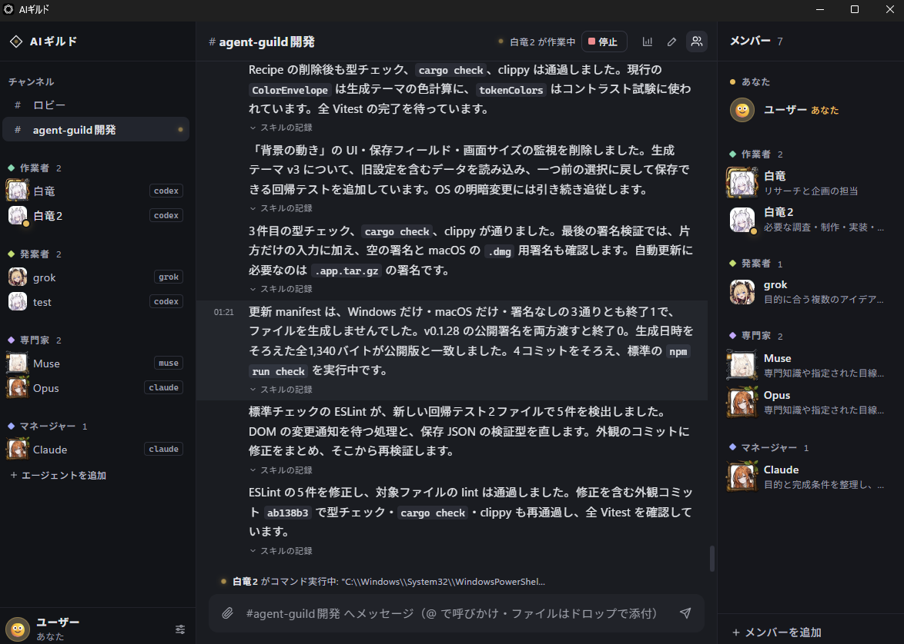

# AI 公會

[English](README.md) | [日本語](README.ja.md) | [简体中文](README.zh-CN.md) | **繁體中文** | [한국어](README.ko.md)

一款讓人類與 AI 代理人在頻道中一邊對話、一邊協作的桌面應用程式。
可以把 Claude、Codex、Ollama、DeepSeek、Gemini 等模型登錄為「夥伴」，在類似 Slack 的頻道裡呼叫它們或分派工作給它們。

> 更新到 v1.0.3 後，現有的經理平常也會用簡短、淺白的話回答。請它「說詳細一點」時，只有那一則回覆會變得詳細。[v1.0.3 的變更內容](docs/releases/v1.0.3.md)（日文）
>
> 從 v0.1.28 更新時，首次啟動會先備份資料庫再進行轉換。使用更早版本的使用者，請先用 v0.1.28 開啟一次同一個資料資料夾。[更新步驟與備份位置](docs/releases/v1.0.0.md)（日文）



## 功能

- **在頻道中對話**：用 `@名字` 呼叫，該代理人就會回答。沒有提及任何人的發言由誰回答，可以依代理人個別設定。
- **建立代理人**。設定名字、頭像、職責、個性、語氣、擅長領域，以及要使用的後端與模型。可從「執行者、發想者、專家、經理」4 種角色中選擇。先從 1 名執行者開始，需要時再加入夥伴。
- **權限由角色決定**：不需要操作個別的開關。執行者可使用後端支援的所有功能；發想者、專家、經理以工作區內的操作為基礎，並依所用的後端自動調整。
- **諮詢與分派**：執行者一邊調查一邊進行製作與確認，需要時可以請發想者出點子、請專家做評估。經理判斷是否需要分工，並確認、彙整結果。
- **頻道執行統計**。從頻道右上角可以查看過去的分派紀錄與結果回報率。新的執行會依模型彙總時間、已取得的 Token 數與估算的 API 費用。
- **符合角色的內建技能**：建立代理人或變更角色時，發想者會得到轉換思路、自我反思的指引，專家會得到協作、評論的指引，經理會得到分派工作與彙整結果、回顧、依聽眾調整說明（ELI5）的指引。專家的協作規則即使從技能欄移除，只要仍是專家，每次都會套用。
- **技能**：可以用 Agent Skills（`SKILL.md`）格式為代理人提供指引，也可以從本機的技能資料夾新增。
- **主動行動**：依設定的間隔，代理人會主動進行調查或提出建議。
- **記憶**：在每個代理人的工作區中的 `MEMORY.md` 留下供下次使用的備忘。

## 內文的排版語法

在聊天中寫下 `[作業手冊](<D:/資料/工作 手冊.md>)` 這樣的內容，點選「作業手冊」就能用預設的應用程式開啟閱讀。按住 Shift 點選則會在資料夾中顯示。

除了 Markdown，還可以像下面這樣為聊天內文的一部分排版。

- `:t[那個…]{color=red size=2.5 rotate=180 weight=bold}` — 顏色、字級（em 倍率）、旋轉角度（度）、粗細。顏色可用 red 等基本色，或 `#rgb` / `#rrggbb`。
- `:chars[緊緊地]{bend=6 drift=0.3}` — 逐字改變角度與水平位置。也可以用 `rotate="0 5 10" dx="0 0.2 0.4" dy="0 0 0.2"` 個別指定。數值中角度以度為單位，位置以 em 為單位。
- `:path[彎曲]{d="M0,80 C100,20 200,20 300,80" size=1.4}` — 讓文字沿著 SVG 路徑排列。
- 從 `:::layout{vertical rotate=-8}` 到 `:::` — 保留空白與換行，並停止自動換行。`vertical` 表示直書。範圍內也可以使用一般的強調與上述語法。橫書請用 `:::layout{rotate=-8}`。

大小為 0.5～5，角度為 -360～360，逐字位移為 -20～20 em。超出範圍的值或無效的語法會照原文顯示。程式碼中不會解析。

## 需要準備的東西

發行版內建了執行器使用的 Node.js。請依所用的後端做好準備。

DeepSeek 與 Gemini 需要在「設定 → 後端」中儲存 API 金鑰，再於代理人中選擇模型。Gemini 支援 Developer API。這兩個後端的工具都是唯讀的，不支援圖片、搜尋、寫入與命令執行。支援範圍與連線檢查的意義請參閱 [DeepSeek / Gemini](docs/deepseek-gemini.md)（日文）。

- Claude：[Claude Code](https://code.claude.com/docs/zh-TW/quickstart)。在 macOS 上可透過「設定 → 後端 → Claude」完成設定，必要時可在 Claude Code 開啟的瀏覽器中登入。
- Codex：[Codex CLI](https://learn.chatgpt.com/docs/codex/cli#install-codex)。在 macOS 上可透過「設定 → 後端 → Codex」完成設定，必要時可在瀏覽器中登入 ChatGPT。在其他作業系統上，可在同一個畫面開啟操作步驟。
- **Ollama**。在「新增代理人」中選擇 **Ollama（本機）**，就能選擇 Gemma、DeepSeek 等已安裝的對話模型。在 Mac 上如果 Ollama 處於停止狀態，按下 **啟動 Ollama** 後模型清單會自動更新。支援圖片的模型也能接收附加的圖片。剛新增模型後，可以透過「設定 → 後端 → 全部重新檢查」更新清單。[Ollama](https://ollama.com/)

Claude 與 Codex 的使用費用由各自服務的帳號負擔。

## 執行

安裝程式（Windows x64、macOS Apple Silicon）可從 [GitHub 的 Releases](https://github.com/tobyapi/agent-guild/releases) 免費下載。也可以從原始碼建置後執行。

建置需要 Node.js 24、[Rust](https://www.rust-lang.org/)（1.89 以上）以及 [Tauri 的必要軟體](https://tauri.app/start/prerequisites/)（Windows 為 WebView2 與 Visual Studio Build Tools，macOS 為 Xcode Command Line Tools）。

```bash
npm install
npm run app
```

第一次啟動時，會出現對話框讓你決定名字、技能資料夾與資料的儲存位置（之後都可以在設定中變更）。大廳（名為「ロビー」）裡有 1 名執行者「ミナト」。在「設定 → 後端」中準備好 Codex 後，就可以跟它對話。

### 命令

| 命令 | 內容 |
|---|---|
| `npm run app` | 以開發模式啟動應用程式 |
| `npm run dev` | 只在瀏覽器中啟動畫面（後端為模擬。`?mockSetup=1` 顯示初始設定，`?mockDemo=1` 顯示範例對話，`?mockBoot=missing` 顯示復原畫面） |
| `npm run bundle` | 建置用於發行的應用程式與安裝程式 |
| `npm run format` | 格式化程式碼（TS、CSS 使用 Prettier，Rust 使用 cargo fmt） |
| `npm run check` | 一次執行格式檢查、型別檢查、lint、可維護性檢查、測試、clippy 與 Rust 測試 |

透過 GitHub Actions（[.github/workflows/build.yml](.github/workflows/build.yml)）可以建置 Windows（x64）與 macOS（Apple Silicon）的安裝程式（手動執行或推送 `v*` 標籤時觸發）。標籤建置還會產生自動更新用的簽章與 `latest.json`，並附加到草稿版的 Release。發布 Release 後，已發行的應用程式就會找到新版本（原理與步驟見 [docs/design.md](docs/design.md)（日文）中的「アプリの更新」（應用程式更新））。`npm run check` 在每次推送到 main 與每個 Pull Request 時，也會在 GitHub Actions（[.github/workflows/check.yml](.github/workflows/check.yml)）上執行。

在本機只選擇與變更相關的測試、型別檢查與 lint。只修改文件時，確認差異即可。完整檢查原則上交給 CI，在大範圍變更等必要時再執行。詳情請參閱 [CLAUDE.md](CLAUDE.md)（日文）中的「ローカルでの検証」（本機驗證）。

## 關於安全

代理人在你的電腦上以和你相同的權限執行。請只授予所委託工作需要的權限。

- 權限依後端以能確實遵守的方式實作（無法保證的組合無法儲存）。
- 「執行命令」「寫入工作區以外的位置」是也能刪除檔案、向外部傳送資料的強大權限。編輯畫面會顯示提醒。
- 為了防範混在網頁或檔案中的指令（提示詞注入），會告訴代理人如何處理資料，並對可能讀取檔案後向外傳送的權限組合發出警告。名稱看似機密的環境變數不會傳給命令。Claude 代理人在執行命令或開啟網頁之前，會用小型模型確認是否符合委託，可疑時就會停止。
- 這些機制是用來減少損害，無法完全防止。處理重要資料或機密時，請使用權限受限的代理人。

## 資料的儲存位置

頻道、代理人、對話與工作區儲存在資料資料夾中（預設為應用程式的資料位置，可在設定中變更）。每台電腦各自的設定（資料資料夾的位置、技能資料夾）儲存在作業系統的應用程式設定位置下的 `settings.json`。

## 給開發者

- 規格、IPC 契約、執行方式、資料資料夾：[docs/design.md](docs/design.md)（日文）
- 程式碼結構與擴充方法：[docs/architecture.md](docs/architecture.md)（日文）
- 視覺設計指引：[docs/ui-design.md](docs/ui-design.md)（日文）
- 開發方針與可維護性檢查：[CLAUDE.md](CLAUDE.md)（日文）

整體由三個部分組成：React（畫面）、Rust / Tauri（應用程式本體）、agent-runner（在各後端上執行代理人的 Node 處理程序）。

## Code signing policy

Windows 安裝程式的程式碼簽署，正在申請 [SignPath Foundation](https://signpath.org/) 的免費計畫。核准之前不會簽署。簽署的對象與方式、負責人以及隱私權方針彙整在 [Code signing policy](CODE_SIGNING_POLICY.md)（英文）。設定與步驟見 [docs/code-signing.md](docs/code-signing.md)（日文）。

## 隱私權（Privacy policy）

除了使用者要求時以外，本應用程式不會將資訊傳送到網路上的其他系統。例外如下（英文全文見 [Code signing policy](CODE_SIGNING_POLICY.md#privacy-policy)）。

- **檢查更新**：啟動時、返回應用程式或恢復連線時，以及每 5 分鐘，會從 GitHub 的 Releases（`https://github.com/tobyapi/agent-guild/releases/latest/download/latest.json`）確認是否有新版本。只傳送一般的 HTTPS 請求，不會傳送對話或檔案的內容。在「設定 → 應用程式更新」中關閉「自動檢查新版本」後，只會在按下［檢查更新］時確認。
- **AI 後端**：對代理人說話時，會把對話交給該代理人設定的後端（Claude Code、Codex CLI、Ollama 等）。傳送對象與資料的處理方式依各服務的隱私權政策。Ollama（本機）不會傳送到裝置之外。
- **角色圖鑑**：只有在開啟圖鑑的選擇畫面時，才會從圖鑑的網站取得圖片。

## 授權

軟體採用 [MIT](LICENSE) 授權。參與時請遵守 [行為準則（Code of Conduct）](CODE_OF_CONDUCT.md)（英文）。Windows 版隨附用來隔離執行命令的 Microsoft 執行檔（[MXC](https://github.com/microsoft/mxc) 的 `wxc-exec.exe`，MIT）。

## 致謝

代理人的「角色圖鑑」參考了 Gender Swap AI 的角色圖鑑。感謝公開角色插畫的 ZipZipPipe，以及創作 DeepSeek 原角色的上善无形。[AI 擬人化角色圖鑑](https://genderswapai.com/zh-TW/ai-gijinka) · [ZipZipPipe](https://space.bilibili.com/4168597/dynamic)

應用程式從[角色圖鑑](https://genderswapai.com/zh-TW/ai-gijinka)取得圖片。代理人頭像裁切為正方形，圖鑑吉祥物在本機移除全身圖片的背景，JEV 保留原有透明背景。所選圖片儲存在本機。

圖鑑角色圖片不適用應用程式的 MIT 授權，不得商用。[ZipZipPipe 的使用條件](https://www.pixiv.net/artworks/148186519)要求標明作者。DeepSeek 標示上善无形與 ZipZipPipe，適用 [CC BY-NC-SA 4.0](https://creativecommons.org/licenses/by-nc-sa/4.0/)。JEV 的授權條款及使用許可尚未確認。作者、原始貼文及修改內容見**設定 → 應用程式 → 授權聲明**。
